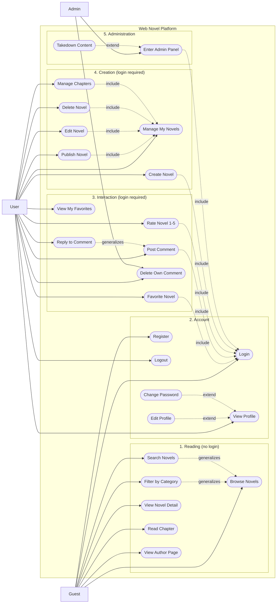

# Use Case Diagram

> Web Novel Platform — 使用案例
> 對應需求清單見 [`../../agent.md`](../../agent.md)；類別設計見 [`02-class-diagram.md`](02-class-diagram.md)。

## 圖例

| 符號 | 意義 |
|---|---|
| 圓角框（stadium） | 使用案例（Use Case） |
| 方括號節點 | 參與者（Actor） |
| `-->` | 參與者與用例的關聯 |
| `-.->\|<<include>>\|` | 必然包含的子用例 |
| `-.->\|<<extend>>\|` | 選擇性延伸（可選功能） |
| 虛線框（subgraph） | 系統邊界 |

## 說明

Mermaid **沒有原生 `useCaseDiagram` 語法**，因此以 `flowchart` 的 stadium 節點（`([文字])`）模擬 UML 用例圖。這不是標準 UML 語法，但視覺效果接近。

> **為何圖中全部使用英文？**
> Mermaid CLI 輸出 PNG 時若環境缺少中文字型，中文會變成方塊（mermaid.live 網頁版通常正常）。
> 為確保在任何環境都能正確顯示，`mermaid` 區塊一律使用英文；中文對照請見下方「用例說明」表格。

若報告需要嚴格 UML（橢圓用例 + 火柴人），可依本圖結構用 draw.io 重畫。

---

## 參與者

| 參與者 | 說明 | 需求 |
|---|---|---|
| **Guest** | 未登入使用者 | — |
| **User** | 所有已登入使用者（**人人皆可創作**） | A1、A2 |
| **Admin** | `is_staff` / `is_superuser` | F1、F2 |

> 本專案**不區分 reader / author**：任何已登入用戶都能發布作品（與 Pixiv / AO3 一致）。
> Admin 亦為 User，具備 User 的全部能力。

---

## Use Case Diagram

---

## 用例說明

### 1. 閱讀（Reading，無需登入）

| 用例（圖上英文） | 中文說明 | 對應需求 | 涉及類別 |
|---|---|---|---|
| Browse Novels | 瀏覽作品列表（首頁、分頁）— **Search / Filter 是其變體** | B1、B2 | `Novel` |
| Search Novels | 以書名／作者名搜尋（generalizes `Browse Novels`） | B3 | `Novel` |
| Filter by Category | 依分類篩選（generalizes `Browse Novels`） | B4 | `Novel`、`Category` |
| View Novel Detail | 封面、簡介、狀態、章節列表、收藏數、平均評分 | B5、B6 | `Novel`、`Chapter`、`Favorite`、`Rating` |
| Read Chapter | 閱讀正文，可上一章／下一章（章節目錄在章節頁內） | C1、C2、C3、C4 | `Chapter` |
| View Author Page | 某作者所有已發布作品 | B7 | `Novel` |

### 2. 帳號（Account）

| 用例（圖上英文） | 中文說明 | 對應需求 | 涉及類別 |
|---|---|---|---|
| Register | 用戶名、Email、密碼 | A1 | `User`、`Profile` |
| Login / Logout | Django 認證 | A2 | `User` |
| View Profile | 暱稱、頭像、簡介 +「我的創作／我的收藏」分頁 | A3 | `Profile`、`Novel`、`Favorite` |
| Edit Profile | 修改暱稱、頭像、簡介（從個人頁進入，`extend` `View Profile`） | A4 | `Profile` |
| Change Password | Django `PasswordChangeForm`（從個人頁進入，`extend` `View Profile`） | A5 | `User` |

### 3. 互動（Interaction，需登入）

| 用例（圖上英文） | 中文說明 | 對應需求 | 涉及類別 |
|---|---|---|---|
| Favorite Novel | 收藏／取消收藏（不得重複） | D1 | `Favorite` |
| View My Favorites | 個人主頁的收藏分頁 | D2 | `Favorite` |
| Post Comment | 在章節下留言 | D3 | `Comment` |
| Reply to Comment | 多層回覆（**generalizes** `Post Comment`：是帶 `parent` 的留言，不限層數） | D6 | `Comment` |
| Delete Own Comment | 本人或 admin 可刪（獨立用例，與「發表」無延伸關係） | D4 | `Comment`、`PermissionStrategy` |
| Rate Novel 1-5 | 每人每作品一筆，可修改 | D7 | `Rating` |

### 4. 創作（Creation，需登入）

| 用例（圖上英文） | 中文說明 | 對應需求 | 涉及類別 |
|---|---|---|---|
| Manage My Novels | 列出自己的作品與狀態 | E1 | `Novel` |
| Create Novel | 標題、封面、簡介、分類、狀態（對應 SD-2：`author = request.user`、`is_published=False`） | E2 | `Novel` |
| Edit Novel | 修改作品資訊 | E3 | `Novel`、`PermissionStrategy` |
| Delete Novel | 連帶刪除章節與留言 | E4 | `NovelService` |
| Manage Chapters | 在自己作品下新增／編輯／刪除／排序章節（對應 SD-3：先驗作品歸屬） | E5、E6 | `Chapter`、`NovelService`、`PermissionStrategy` |
| Publish Novel | 設定作品曝光（`is_published=True`，經 `NovelService.publish()`），不要求有章節 | E7 | `Novel`、`NovelService`、`PermissionStrategy` |

### 5. 管理（Administration）

| 用例（圖上英文） | 中文說明 | 對應需求 | 涉及類別 |
|---|---|---|---|
| Enter Admin Panel | `is_staff` 才可進入 Django Admin | F1 | `User` |
| Takedown Content | **作品**：`is_published=False`；**章節／留言**：`is_active=False` | F2 | `Novel`、`Chapter`、`Comment` |

> Takedown 只能在 Admin Panel 內觸發（實作就是 Django Admin 的 action），因此圖上以 `<<extend>>` 依附 `Enter Admin Panel`，Admin 不直接連到它。

### 系統（System）

| 用例 | 說明 | 對應需求 |
|---|---|---|
| 切換語言（中／英） | 導覽列下拉選單，Django i18n + gettext | G1 |

> 語言切換在圖中未畫成獨立用例，因為它屬於全域 UI 行為，在每個頁面都可用；實作上是模板中的 `` 表單。

---

## 關係說明（為什麼這樣連）

### Generalization（泛化）：是一種（is-a）

| 子用例 | 父用例 | 理由 |
|---|---|---|
| `Reply to Comment` | `Post Comment` | 回覆**就是**一則帶 `parent` 的留言，是留言的一種 |
| `Filter by Category` | `Browse Novels` | 帶分類條件的瀏覽，是瀏覽的一種方式 |
| `Search Novels` | `Browse Novels` | 帶關鍵字條件的瀏覽，是瀏覽的一種方式 |

> **為什麼不用 `<<extend>>`**：篩選／搜尋不是「先瀏覽、再附加」的額外步驟，而是**瀏覽本身的一種形式**。extend 會暗示「使用者在瀏覽流程中選擇附加篩選」，與實際操作不符。
>
> **為什麼 `Reply` 不用 `<<include>>`**：include 表示「必然執行的子步驟」。但回覆**不會先發一則普通留言、再發回覆**——回覆本身就是那則留言。所以 `Reply` 是 `Post Comment` 的**變體**（is-a），不是它的子步驟。原本誤用 include 的理由（「共用建立流程」）只說明程式碼可重用，不是 UML 的 include。

### `<<include>>`：必然發生的子行為

| 基礎用例 | 包含 | 理由 |
|---|---|---|
| `Publish` / `Edit` / `Delete` / `Manage Chapters` | `Manage My Novels` | 都要先在自己作品清單選定作品 |
| `Favorite` / `Post Comment` / `Rate` / `Create Novel` / `Enter Admin Panel` | `Login` | 前置條件（見下方說明） |

> ※ 圖上共 **9 條** `<<include>>` 連線：4 條指向 `Manage My Novels`、5 條指向 `Login`（`Favorite`、`Post Comment`、`Rate`、`Create Novel`、`Enter Admin Panel`）。
>
> **`Manage My Novels` 不畫 `include Login`**：若畫了，`Edit / Delete / Manage Chapters / Publish` 會透過 `MyNovels` 間接 include `Login`，形成 `Edit → MyNovels → Login` 的 include 循環，而 UML 明確禁止 include 循環。「需登入」對這些用例一律視為 **precondition**。

### `<<extend>>`：可選的附加行為

| 延伸用例 | 基礎用例 | 理由 |
|---|---|---|
| `Edit Profile` | `View Profile` | 從個人頁點「編輯」才會進入；不點也能單純查看 |
| `Change Password` | `View Profile` | 從個人頁設置區進入；不點也能單純查看 |
| `Takedown Content` | `Enter Admin Panel` | 進入後台是基本行為；下架違規內容是**可選的額外操作** |

> **`Edit Profile` / `Change Password` 用 extend 的說明**：兩者目標雖與「查看」不同，但在**使用流程**上確實是從個人主頁延伸出去的可選操作（使用者在個人頁決定是否要改資料或改密碼）。這是本專案對 extend 的實務用法，標準 UML 嚴格派可能主張應獨立連 `User`，此處已在「已知的簡化」說明。

### ⚠️ 已知的簡化（報告請照此說明）

1. **`Login` 以 `<<include>>` 表示**：嚴格 UML 應把「已登入」寫成用例的 **precondition**，或讓 `User` 泛化 `Guest`。本圖僅畫 5 條 `--> Login`（`Favorite`、`Post Comment`、`Rate`、`Create Novel`、`Enter Admin Panel`）；其餘需登入的用例（`View My Favorites`、`Reply`、`Delete Comment`、`Edit/Delete Novel`、`Manage Chapters`、`Publish`、`Manage My Novels`）一律視為同樣的 precondition，不重複畫線（也避免 include 循環）。
2. **沒有畫 actor generalization**：`Admin` 亦具備 `User` 的全部能力，圖上省略其連線，以免數十條線交叉。
3. **純導航關係不畫線**：`View Novel Detail → View Author Page` 只是頁面超連結，不是 `<<include>>`（看詳情不必然開作者頁），因此改由參與者直接連到 `View Author Page`。
4. **generalization 用虛線箭頭 `-.->|generalizes|`**：Mermaid `flowchart` 不支援 UML 的空心三角箭頭（`--|>`），以虛線箭頭妥協表示；語義方向為「子用例 → 父用例」。
5. **章節目錄併入 `Read Chapter`**：章節目錄屬於閱讀頁面的一部分（側欄目錄 + 上一章/下一章），不另立用例，C3 由 `Read Chapter` 涵蓋。
6. **`Edit Profile` / `Change Password` 用 extend 的說明**：兩者從個人頁發起，使用者停留在「我的帳號」情境，操作完成後回到查看頁，因此以 `extend` 表示「入口延伸」。嚴格 UML 可主張目標不同（查看 vs 修改），此處屬實務用法。
7. **`Takedown Content` 沒有參與者連線**：由 Admin 在 Admin Panel 內觸發，透過 `extend` 關係可達，語義正確。

> **⚠️ 已修正的錯誤（保留記錄供報告參考）**
>
> | 原本 | 問題 | 修正 |
> |---|---|---|
> | `Reply Comment --extend--> Post Comment` | 回覆不是「可選附加步驟」，而是留言的子類型 | 改 `<<include>>`（**後再改為 generalization**） |
> | `Reply Comment --include--> Post Comment` | include 表示「必然執行的子步驟」，但回覆本身就是那則留言，不是先發留言再回覆 | **改 `generalizes`**（is-a） |
> | `Delete Comment --extend--> Post Comment` | 刪除與發表目標相反，毫無延伸關係 | 改為獨立用例 |
> | `Publish Novel --extend--> Edit Novel` | 發布 ≠ 編輯 | 各自 `<<include>>` `Manage My Novels` |
> | `Edit/Delete/ManageChapters --extend--> My Novels` | 「管理作品」底下的操作不是附加行為 | 改 `<<include>>` |
> | `View Novel Detail --include--> View Author Page` | 看詳情不會**必然**開作者頁，只是連結 | 刪除，改由 Guest 直連 |
> | 章節目錄曾獨立為用例 | 章節頁已含目錄，獨立畫出會造成孤島節點 | 刪除該節點，C3 併入 `Read Chapter` |
> | `Admin --> Takedown` **且** `Takedown --extend--> AdminPanel` | 同時「可主動發起」又「只能依附」矛盾 | 移除 `Admin --> Takedown` |
> | `Read Chapter` 沒有參與者連線 | C4「免登入閱讀」看不出來 | 加 `Guest --> Read Chapter` |
> | `Search Novels` / `Filter by Category` 與 `Browse Novels` 平行 | 兩者其實是瀏覽的變體，不是獨立用例 | 改 `generalizes` |
> | `Edit Profile` / `Change Password` 只連 `User` | 實務上是從個人頁延伸的操作 | 改 `extend` `View Profile` |
>
> **關係判準總表**
>
> | 關係 | 判準 | 本圖用途 |
> |---|---|---|
> | `generalization` | **是一種（is-a）** | Reply 是 Comment；Search/Filter 是 Browse |
> | `<<include>>` | **必然執行的子步驟** | 創作前先選作品；登入前置條件 |
> | `<<extend>>` | **可選的附加行為，不改變主用例目標** | Takedown（嚴格符合定義） |
> | `<<extend>>`（實務用法） | 從同一頁面/情境延伸出的操作，完成後回到原頁 | Edit Profile、Change Password（見「已知的簡化」第 6 點） |

---

## 對應的 Sequence Diagram

以下 5 個核心用例另有動態行為圖，見 [`04-sequence.md`](04-sequence.md)：

| 用例 | Sequence Diagram | 展示重點 |
|---|---|---|
| `Create Novel` | SD-2 | 輸入書名建新書、`author = request.user`、預設 `is_published=False` |
| `Manage Chapters` | SD-3 | 先驗作品歸屬（`AuthorOrAdminStrategy`）→ `get_next_order()`、軟刪除不重排 `order` |
| `Favorite Novel` | SD-1 | 收藏／取消收藏 toggle、登入前置、`UniqueConstraint` |
| `Post Comment` / `Reply to Comment` | SD-4 | `CommentForm.clean()` 只驗證父留言存在（v2 起不限回覆層數） |
| `Delete Novel` | SD-5 | `PermissionStrategy` 三分支、硬刪除 CASCADE |
| `Publish Novel` | SD-2 的「附帶動作：發布」段落 | 經 `NovelService.publish()`、需權限、不檢查章節數（流程僅 2 步，未獨立成圖） |

> **SD-2 → SD-3 的先後關係**：`Novel` 必須先存在，才能在其底下建立 `Chapter`（FK 相依）。因此 SD-3 的每個操作都先驗證「這本書是不是你的」。
>
> 其餘用例的流程可由這 5 張圖類推（例如 `Rate Novel` 與 `Favorite` 形狀相同：檢查是否已有評分，有則 `update`、無則 `create`；`Edit Novel` 與 SD-2 的存檔步驟相同，改用 `ModelForm` 的 `instance=` 參數）。

---

## 需求覆蓋檢查

> 狀態欄分成「圖上有明確用例」與「依 agent.md 的優先級」，避免把 🔵／🟡 誤寫成必須。

| 需求 | 優先 | 對應用例 | 圖上覆蓋 |
|---|---|---|---|
| A1 註冊 | ✅ | Register | ✅ |
| A2 登入／登出 | ✅ | Login、Logout | ✅ |
| A3 個人主頁 | ✅ | View Profile | ✅ |
| A4 編輯個人資料 | 🔵 | Edit Profile | ✅ |
| A5 修改密碼 | 🔵 | Change Password | ✅ |
| A6 權限規則 | ✅ | 各用例的 Login include + `PermissionStrategy`；admin 對他人的操作由 F1 Admin 涵蓋 | ✅ |
| B1 首頁 | ✅ | Browse Novels | ✅ |
| B2 作品列表 | ✅ | Browse Novels | ✅ |
| B3 搜尋 | ✅ | Search Novels | ✅ |
| B4 分類篩選 | ✅ | Filter by Category | ✅ |
| B5 作品詳情頁 | ✅ | View Novel Detail | ✅ |
| B6 排序 | 🔵 | Browse Novels（列表排序） | ✅ |
| B7 作者主頁 | 🔵 | View Author Page | ✅ |
| C1 章節閱讀 | ✅ | Read Chapter | ✅ |
| C2 上一章／下一章 | ✅ | Read Chapter（含導航） | ✅ |
| C3 章節目錄 | ✅ | Read Chapter（章節頁內含目錄） | ✅ |
| C4 免登入閱讀 | ✅ | `Guest --> Read Chapter` | ✅ |
| C5 閱讀進度 | ✅ | Read Chapter（記錄進度）＋ View Novel Detail（續讀） | ✅ |
| D1 收藏／取消 | ✅ | Favorite Novel | ✅ |
| D2 我的收藏 | ✅ | View My Favorites | ✅ |
| D3 章節評論 | ✅ | Post Comment | ✅ |
| D4 刪除評論 | ✅ | Delete Own Comment（admin 可刪他人由 Admin 涵蓋） | ✅ |
| D5 評論分頁 | 🔵 | Post Comment（章節頁 Paginator，每頁 20） | ✅ |
| D6 評論回覆 | 🔵 | Reply to Comment（generalizes Post Comment） | ✅ |
| D7 作品評分 | 🔵 | Rate Novel 1-5 | ✅ |
| E1 我的作品 | ✅ | Manage My Novels | ✅ |
| E2 新建作品 | ✅ | Create Novel | ✅ |
| E3 編輯作品 | ✅ | Edit Novel | ✅ |
| E4 刪除作品 | ✅ | Delete Novel | ✅ |
| E5 章節管理 | ✅ | Manage Chapters | ✅ |
| E6 章節排序 | ✅ | Manage Chapters | ✅ |
| E7 發布控制 | 🔵 | Publish Novel | ✅ |
| E8 作品統計 | 🟡 | — | ⬜ 未納入（加分項） |
| F1 Django Admin | ✅ | Enter Admin Panel | ✅ |
| F2 內容下架 | 🟡 | Takedown Content | ✅ |
| G1 UI 與 i18n | ✅ | 切換語言（全域） | ⚠️ 未畫成獨立用例 |
| G3 表單驗證 | ✅ | 各用例的表格說明 | ⚠️ 非獨立用例 |
| G4 自動化測試 | ✅ | — | ➖ 開發活動 |
| G5 種子資料 | 🔵 | — | ➖ 開發活動 |

---

## Mermaid 的限制

1. **Mermaid 沒有 `useCaseDiagram` 原生語法** — 本圖以 `flowchart` 模擬，節點為 stadium 形狀。
2. **參與者不是火柴人** — 以文字節點表示。
3. **`<<include>>` / `<<extend>>` 以虛線箭頭標註** — 語意正確，但圖例樣式與標準 UML 不同。
4. **PNG 輸出不含中文字型** — 若需中文圖，請用 mermaid.live 網頁版匯出，或安裝中文字型後重跑 mermaid-cli。
5. 若報告要求標準 UML 用例圖，建議用 **draw.io**（模板：UML → Use Case）依本結構重畫。

---

## 已驗證

本段 Mermaid 語法已用 `@mermaid-js/mermaid-cli`（v12.2.0）實際渲染通過，可正常輸出 PNG。

## 如何預覽

1. 開 <https://mermaid.live>，貼上上面的 `mermaid` 區塊。
2. 或安裝 VS Code 擴充 **Markdown Preview Mermaid Support** 直接預覽此檔。
3. 匯出：mermaid.live → `Actions` → `Download PNG / SVG`。

---

## v2 擴充（補充）

| 功能 | 實作方式 | 需求 |
|---|---|---|
| 閱讀進度 | `ReadingProgress`（每用戶每作品一筆），詳情頁「Continue reading」 | C5 |
| 排行榜 / 最近更新 | `/rankings/`（最熱/最多瀏覽/最高評分/最多討論/最新）、`/recent/` | — |
| 標籤、狀態、字數篩選 | `Tag` M2M + `novel_list` 篩選參數 | — |
| 卷階層 | `Volume` model + 建立端點 | C4 |
| 章節草稿 / 定時發布 | `is_draft` / `scheduled_at`（讀取時判斷） | C6 |
| 章節目錄頁 | `/novels/<pk>/toc/`（依卷分組、錨點） | — |
| 寫作大綱 | `OutlineItem` + 大綱端點 | — |
| 多層留言 / 讚 / 劇透 | `likes` M2M、`is_spoiler`、`parent` 不限層數 | — |
| 追蹤作者 | `Follow` | — |
| 通知 | `Notification`（資料庫輪詢、非即時推送） | — |
| Email 驗證 | `Profile.email_verified` | — |
| 密碼重設 | Django `PasswordResetView` | — |
| 違規檢舉 | `Report`；admin 於後台處理 | F2 |
| 只讀 JSON API | `/api/novels/`、`/api/novels/<pk>/`（列表） | — |
