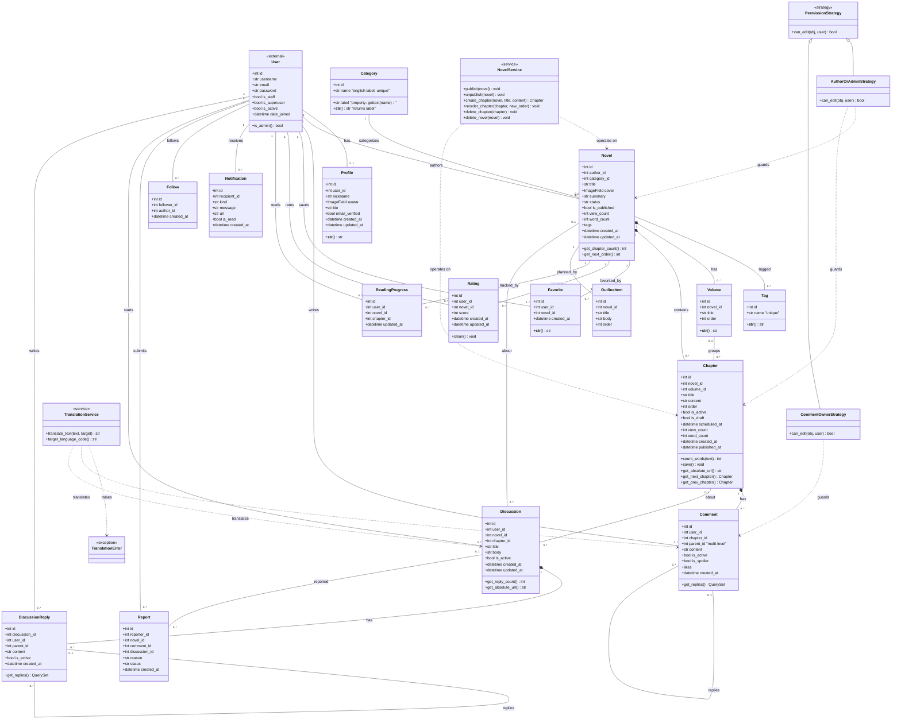

# UML Class Diagram

> Web Novel Platform — 領域模型（Domain Model）
> 對應需求清單見 [`../../agent.md`](../../agent.md)；資料表設計見 [`03-er-diagram.md`](03-er-diagram.md)。

## 圖例

| 符號 | 意義 |
|---|---|
| `<<external>>` | Django 內建類別，非本專案撰寫 |
| `<<service>>` | Service Layer，封裝跨模型業務流程 |
| `<<strategy>>` | Strategy Pattern，可替換的權限判斷策略 |
| `*--` | 組合（Composition，父物件刪除連帶刪除子物件） |
| `--` | 關聯（Association） |
| `..>` | 依賴（Dependency） |
| `<\|--` | 繼承（Inheritance / Realization） |
| `"1" -- "*"` | 一對多 |
| `"1" -- "1"` | 一對一 |
| 獨立關聯類別 | `Favorite` / `Rating` 承載「多對多」關係與額外屬性 |

> **外鍵命名說明**
> 本圖以 **Django FK 屬性名**表示外鍵（如 `Novel.author`），資料庫實際欄位為 `author_id`、`user_id`、`chapter_id`（詳見 [`03-er-diagram.md`](03-er-diagram.md)）。
> 為避免與 Django 自動產生的 `<field>_id` 屬性衝突，**model 欄位宣告一律不帶 `_id` 後綴**，例如：
> ```python
> author = models.ForeignKey(User, on_delete=models.CASCADE)   # ✅
> author_id = models.ForeignKey(User, on_delete=models.CASCADE) # ❌ 與 ORM 屬性衝突
> ```
> 圖上的 `+int author_id` 等是**資料庫欄位的視圖**，用來對應 ER 圖；實際建立 model 時請用 `author`。

> **組合（`*--`）語義說明**
> 圖中 `Novel *-- Chapter`、`Chapter *-- Comment` 使用組合符號，是因為資料庫層採用 `on_delete=CASCADE`（父刪子刪）。
> 但 F2「內容下架」**不是刪除**：**作品**用 `is_published=False`；**章節／留言**用 `is_active=False`（軟刪除），詳見各類別說明。

---

## Class Diagram



---

## 類別說明

### `User`（`<<external>>`，Django `django.contrib.auth.models.User`）

- 本專案的帳號基底，直接使用 Django 內建實作（密碼雜湊、登入認證、權限）。
- 不新增 role 欄位：**人人皆可創作**，以 `is_staff` / `is_superuser` 區分 admin。
- `id` 為 Django 自動產生的 `BigAutoField` 主鍵（`DEFAULT_AUTO_FIELD = 'django.db.models.BigAutoField'`）。
- `is_admin()`：判斷是否為管理員，**為 admin 判定的單一權威來源**；Strategy 內部一律呼叫此方法，不直接讀 `is_staff`（對應需求 A6、F1）。

### `Profile`（`accounts`）

- 與 `User` 一對一（OneToOne），儲存平台專屬資料：暱稱、頭像、簡介。
- 主鍵 `id`；外鍵 `user`（DB 欄位 `user_id`）。
- 對應需求：A3（個人主頁）、A4（編輯個人資料）。

### `Category`（`novels`）

- 作品分類，作品頁可依分類篩選（G1）。
- 主鍵 `id`；`name` 加 `unique=True`，只存英文標籤（如 `Fantasy`）。
- 顯示文字由 `label` 屬性提供：`label = gettext(name)`，依目前介面語言回傳
  「奇幻」或「Fantasy」。`__str__()` 回傳 `label`，所以表單下拉選單與
  `__str__` 顯示都會自動翻譯；範本使用 `{{ category.label }}`。
- 翻譯放在 `locale/zh_Hant/LC_MESSAGES/django.po`，程式碼與資料庫都不含中文。
- 對應需求：B4（分類篩選）、F1（Admin 管理）、G1（雙語）。

### `Novel`（`novels`）

- 作品本體，`author` 為 FK → `User`，`category` 為 FK → `Category`。
- `status`：`ongoing`（連載中）／`completed`（已完結），以 `choices` 限制，**預設 `ongoing`，不允許空字串**。
- `is_published`：**作品曝光開關**（對應 E7、F2）。建立時預設 `False`（未發布），作者按「發布」後為 `True`。**發布動作不放在 model 上**，交由 `NovelService.publish()` 處理。
- ⚠️ **發布不要求有任何章節**：「有沒有章節」不能作為發布條件。零章節的作品發布後，詳情頁顯示「暫無章節」。章節另有 `is_draft` / `scheduled_at` 控制單章可見性，但與作品的 `is_published` 是兩回事。
- `get_chapter_count()`：章節數，用於作品頁與列表。
- `get_next_order()`：計算下一個章節編號。
- **`updated_at` 的維護**：`auto_now=True` 只在**儲存 `Novel` 自身**時更新。新增／刪除章節時，由 `NovelService.create_chapter()` / `delete_chapter()` 同時執行 `novel.save(update_fields=['updated_at'])`，否則「最新更新」（B1）與索引 `(is_published, -updated_at)` 不會反映章節變動。
- 收藏數／評論數／平均評分**不在 model 上計算**，由 view 層以 `annotate(Count('favorite'))`、`annotate(Count('comment'))`、`annotate(Avg('rating__score'))` 完成（B1 熱門收藏、B6 排序、E8 作品統計）。理由：聚合是查詢層的事，放進 model 會造成 N+1 查詢。
- 「作品下架」（admin）是把 `is_published` 設為 `False`，`Novel` 沒有 `is_active` 欄位。
- 對應需求：B5、B6、B7、E1–E4、E7、E8、D7、F2。

### `Chapter`（`novels`）

- 屬於 `Novel` 的組合（`Novel` 刪除 → 章節連帶刪除）。
- 主鍵 `id`；外鍵 `novel`（DB 欄位 `novel_id`）、可空外鍵 `volume`（`SET_NULL`，對應 C4 卷階層）。
- `order`：章節順序（對應 E6）；`(novel, order)` 有 `UniqueConstraint`。
- `is_active`：軟刪除／下架旗標（對應 F2）。**下架只把 `is_active` 設為 `False`，不重新排序**（保留原 `order` 以免違反唯一約束）。
- `is_draft` / `scheduled_at`：單章可見性（v2）。`is_draft=True` 或 `scheduled_at` 尚未到期時，讀者看不到此章；由 `ChapterQuerySet.visible()` 統一過濾。
- `view_count` / `word_count`：瀏覽數與字數（v2）；`save()` 會自動以 `count_words()` 重算 `word_count`。
- `published_at`：**章節建立時間**，由 `NovelService.create_chapter()` 寫入 `now()`。此欄不是「發布開關」；可見性由 `is_draft` / `scheduled_at` 判斷，作品曝光由 `Novel.is_published` 決定。
- `count_words(text)`：字數計算（CJK 逐字、Latin 逐詞）。
- `get_next_chapter()` / `get_prev_chapter()`：閱讀頁導航（對應 C2），只回傳 `is_active=True` 的章節。
- `get_absolute_url()`：導向閱讀頁。
- 對應需求：C1–C3、C4、C6、E5、E6、D3、F2。

### `Favorite`（`interaction`）

- 關聯類別：`User × Novel`，帶 `created_at`。
- 主鍵 `id`；外鍵 `user`、`novel`。
- `UniqueConstraint(user, novel)` 防止重複收藏（對應 D1）。
- 對應需求：D1、D2。

### `Comment`（`interaction`）

- 掛在 `Chapter` 下（設計決策 2）；`parent` 自關聯支援**多層回覆**（D6，v2 放寬為不限層數）。
- 主鍵 `id`；外鍵 `user`、`chapter`、可空 `parent`。
- `is_active`：軟刪除／下架旗標（對應 F2、D4）。**下架與刪除皆只把 `is_active` 設為 `False`**，不觸發資料庫 CASCADE，也不重排其他留言；刪除父留言時子回覆一併隱藏（由 view 處理）。
- `is_spoiler`：劇透標記（v2）；`likes`：按讚 M2M（v2）。
- `get_replies()`：取得此留言的有效回覆（`Comment.objects.active().filter(parent=self)`）。
- 多層回覆規則由 **`CommentForm.clean()`** 驗證：只檢查父留言存在於同章節（不限層數）（對應 G3）。
- 刪除權限由 `CommentOwnerStrategy` 判斷（見 Design Patterns），model 不自帶 `can_delete`。
- 對應需求：D3–D6。

### `Rating`（`interaction`）

- 關聯類別：`User × Novel`，每人對每部作品僅一筆，可修改。
- 主鍵 `id`；外鍵 `user`、`novel`。
- `score` 限制 1–5，於 `clean()` 驗證（對應 G3）。
- `UniqueConstraint(user, novel)` 保證唯一；`updated_at` 記錄最後修改時間（D7「可修改」）。
- 對應需求：D7。

### 為什麼只有部分 model 有 `updated_at`

| Model | `created_at` | `updated_at` | 理由 |
|---|---|---|---|
| `Profile` | ✅ | ✅ | 暱稱／頭像／簡介可編輯（A4） |
| `Novel` | ✅ | ✅ | 作品資訊可編輯（E3）；B1「最新更新」與排序依賴此欄 |
| `Rating` | ✅ | ✅ | 評分可修改（D7），需要「最後修改時間」 |
| `Category` | ❌ | ❌ | 由 admin 建立，變動極少，不需時間戳 |
| `Chapter` | ✅ | ❌ | 章節建立後不追蹤編輯時間；有新章節時改動的是 `Novel.updated_at` |
| `Favorite` | ✅ | ❌ | 收藏是一次性動作，沒有「編輯收藏」的情境 |
| `Comment` | ✅ | ❌ | **本專案不支援編輯留言**（只有發表與刪除，D3／D4），因此只需建立時間 |

> 原則：**只有「使用者可以反覆修改」的實體才需要 `updated_at`**。`Comment` 沒有編輯功能，這是刻意的範圍限制（見 `agent.md` 的 Scope）。

### `NovelService`（`<<service>>`，`novels/services.py`）

**Service Layer Pattern** — 封裝「跨多個 model」的業務流程，讓 view 只剩 HTTP 處理。

| 方法 | 職責 |
|---|---|
| `publish(novel)` | 設 `is_published=True` → 存檔（**不檢查章節數**，理由見 SD-2） |
| `unpublish(novel)` | 設 `is_published=False` → 存檔（E7 再次發布切換 / F2 下架，資料保留） |
| `create_chapter(novel, title, content)` | 以 `get_next_order()` 計算 `order`、寫入 `published_at`、建立章節，並更新 `novel.updated_at`（供 B1「最新更新」排序） |
| `reorder_chapter(chapter, new_order)` | 移動章節並重排其他章節的 `order`（同作品內） |
| `delete_chapter(chapter)` | 把 `is_active` 設為 `False`（軟刪除），**不重排 `order`**，避免違反 `(novel, order)` 唯一約束；同時更新 `novel.updated_at` |
| `delete_novel(novel)` | **硬刪除**作品本體（FK CASCADE 連帶章節、留言、收藏、評分），對應 E4 |

**刪除策略（統一）**

| 操作 | 方式 | 原因 |
|---|---|---|
| `delete_novel()` | **硬刪除** | 作品是聚合根，使用者預期整部作品消失 |
| `delete_chapter()` | **軟刪除**（`is_active=False`） | 保留章節以免留言失去錨點、避免 `(novel, order)` 唯一約束衝突 |
| 刪除留言（D4） | **軟刪除**（`is_active=False`） | 同上，且 D4 要求「留言者或 admin」才能刪，走 view 而非 service |

> `on_delete=CASCADE` 只在真正呼叫 `obj.delete()` 時生效；軟刪除不會觸發。

**為什麼不放在 model 上**：這些操作需要一次改動多筆記錄，放在 model instance method 容易寫出「隱含副作用」的程式碼；抽到 service 後可獨立寫單元測試。

**注意**：E2（新建作品）與 E3（編輯作品）走一般 `ModelForm`，不使用 service——兩者都只涉及單一 model，`ModelForm` 已足夠；只有涉及多模型或順序調整的操作才經 service。E2 的 `author` 由 view 於 `form.save(commit=False)` 後指定為 `request.user`，不從表單接收（見 SD-2）。

### `PermissionStrategy`（`<<strategy>>`，`accounts/permissions.py`）

**Strategy Pattern** — 把「誰可以編輯／刪除」的規則抽成可替換的物件。

```python
# 概念示意
class PermissionStrategy:
    def can_edit(self, obj, user) -> bool: ...

class AuthorOrAdminStrategy(PermissionStrategy):
    # Novel：作者本人 或 admin
    # Chapter：傳入 chapter.novel（Chapter 沒有 author 欄位）
    def can_edit(self, novel, user):
        if user.is_admin():
            return True
        return novel.author_id == user.pk

class CommentOwnerStrategy(PermissionStrategy):
    # Comment：留言者本人 或 admin
    def can_edit(self, comment, user):
        return user.is_admin() or comment.user_id == user.pk
```

> **為什麼參數叫 `novel` 而非 `obj`**：`AuthorOrAdminStrategy` 只守衛 `Novel` 與 `Chapter`，而 `Chapter` 沒有 `author` 欄位，必須先取 `chapter.novel` 再判斷。因此呼叫端一律傳入 **`Novel` 實例**（處理章節時傳 `chapter.novel`），策略內部不需要 `isinstance` 判斷型別。

**好處**：`Novel` 與 `Chapter` 共用 `AuthorOrAdminStrategy`，`Comment` 使用 `CommentOwnerStrategy`；規則集中、可測試、日後可加「版主」等新策略而不動現有程式碼。admin 判定統一走 `User.is_admin()`。

---

## Design Patterns Used

| Pattern | 類別 / 位置 | 說明 |
|---|---|---|
| **Active Record** | 所有 Model（Django ORM） | model 實例自身負責 `save()` / `delete()` 等資料存取 |
| **Service Layer** | `NovelService` | 封裝發布作品、章節排序等跨模型流程 |
| **Strategy** | `PermissionStrategy` 及其子類 | 權限判斷規則可替換、集中管理 |
| Template Method（框架） | `Rating.clean()`、`Model.save()` | Django 提供的 hook 機制 |
| Decorator（框架） | `@login_required`、`@require_POST` | Django view 裝飾器 |
| Front Controller（框架） | `config/urls.py` | 統一請求入口 |

---

## 關聯摘要

| 關係 | 類型 | 多重性 | 實作 |
|---|---|---|---|
| User — Profile | OneToOne | 1 : 0..1 | `Profile.user = OneToOneField(User, on_delete=CASCADE)`；以 `post_save` signal 於註冊時自動建立，因此正常流程下必存在，但資料層允許不存在 |
| User — Novel | Association（FK） | 1 : 0..N | `Novel.author = ForeignKey(User, on_delete=CASCADE)` |
| Category — Novel | Association（FK） | 1 : 0..N | `Novel.category = ForeignKey(Category, on_delete=PROTECT)` |
| Novel — Chapter | Composition | 1 : 0..N | `Chapter.novel = ForeignKey(Novel, on_delete=CASCADE)`；**發布作品不要求有章節**（零章節作品可發布，詳情頁顯示「暫無章節」） |
| Chapter — Comment | Composition | 1 : 0..N | `Comment.chapter = ForeignKey(Chapter, on_delete=CASCADE)`；下架用 `is_active=False`，不是刪除 |
| Comment — Comment | Self-association | 0..1 : 0..N | `parent = ForeignKey('self', null=True, on_delete=CASCADE)` |
| User — Comment | Association（FK） | 1 : 0..N | `Comment.user = ForeignKey(User, on_delete=CASCADE)` |
| User × Novel（收藏） | ManyToMany via `Favorite` | M : N（每對 0..1） | 兩 FK + `UniqueConstraint` |
| User × Novel（評分） | ManyToMany via `Rating` | M : N（每對 0..1） | 兩 FK + `UniqueConstraint` |
| NovelService → Novel / Chapter | Dependency | — | 以參數接收 model 實例 |
| PermissionStrategy ← AuthorOrAdmin / CommentOwner | Inheritance | — | 子類覆寫 `can_edit()` |

> **多重性說明**：`Novel`、`Chapter` 的關係寫成 `0..*` 是因為**作品可以在沒有任何章節的情況下建立並發布**。`Favorite` / `Rating` 雖然畫成 `User 1 — 0..* Favorite`、`Novel 1 — 0..* Favorite`，但受 `UniqueConstraint(user, novel)` 限制，**每一對 (user, novel) 最多一筆**。

> **UML 正確性**：本圖的關係符號與多重性已逐一人工核對，並以 mermaid-cli 實際渲染驗證通過。Mermaid 的 `classDiagram` 對 UML 支援為簡化版（不支援注釋框、部分標註語法）；若需標準 UML 呈現，可依本圖結構用 draw.io 重畫。

---

## 需求追溯表（Traceability）

| 類別 / 元素 | 對應需求編號 |
|---|---|
| `User` | A1、A2、A6、F1 |
| `Profile` | A3、A4、A5 |
| `Category` | B4、F1、G1 |
| `Novel` | B1–B7、E1–E4、E7、E8、D7 |
| `Chapter` | C1–C4、C6、E5、E6、D3、F2 |
| `Volume` | C4 |
| `Tag` | B6（標籤篩選） |
| `Favorite` | D1、D2 |
| `Comment` | D3–D6、F2、G3 |
| `Rating` | D7、G3 |
| `ReadingProgress` | C5 |
| `Notification` | 通知（v2） |
| `Follow` | 追蹤作者（v2） |
| `Report` | F2（檢舉佇列，v2） |
| `OutlineItem` | 寫作大綱（v2） |
| `NovelService` | E4、E5、E6、E7、F2 |
| `PermissionStrategy` | A6、D4、E3、E4 |

---

## 與程式碼的對應

| 類別 | Django App / 檔案 |
|---|---|
| `User` | Django 內建（`django.contrib.auth`） |
| `Profile` | `accounts/models.py` |
| `Category`、`Tag`、`Novel`、`Volume`、`Chapter` | `novels/models.py` |
| `NovelService` | `novels/services.py` |
| `Favorite`、`ReadingProgress`、`Comment`、`Rating`、`Notification`、`Follow`、`Report`、`OutlineItem` | `interaction/models.py` |
| `PermissionStrategy` 等 | `accounts/permissions.py` |

---

## 已驗證

本段 Mermaid 語法已用 `@mermaid-js/mermaid-cli`（v12.2.0）實際渲染通過，可正常輸出 PNG。

## 如何預覽

1. 開 <https://mermaid.live>，貼上上面的 `mermaid` 區塊。
2. 或安裝 VS Code 擴充 **Markdown Preview Mermaid Support** 直接預覽此檔。
3. 匯出：mermaid.live → `Actions` → `Download PNG / SVG`。

> **向量版本**：同目錄另提供 `class-diagram.svg`（向量，放大／列印不失真），`class-diagram.png` 保留作為預覽縮圖。SVG 由 `mmdc -i … -o class-diagram.svg` 產生。
