# ER Diagram（實體關聯圖）

> Web Novel Platform — 資料庫設計
> 對應類別設計見 [`02-class-diagram.md`](02-class-diagram.md)；需求清單見 [`../../agent.md`](../../agent.md)。

> **說明**：本文件描述 SQLite 的實體資料表。Django 系統表（`django_migrations`、`auth_permission`、`django_session`、`django_admin_log`、`auth_group`）由框架自動管理，不在此列出。

## 圖例

Mermaid `erDiagram` 的基數符號由**兩端各兩個字元**組合，讀法是「左端符號 → 右端符號」：

| 端點符號 | 意義 |
|---|---|
| `\|` | **必為 1**（exactly one） |
| `o` | **可為 0**（zero） |
| `\|\|` | 1 且必為 1 → `1` |
| `o\|` | 0 或 1 → `0..1` |
| `o{` | 0 或多 → `0..*` |
| `\|{` | 1 或多 → `1..*` |

| 組合 | 意義 | 本圖用途 |
|---|---|---|
| `\|\|--o\|` | 一對零或一 | `AUTH_USER → ACCOUNTS_PROFILE` |
| `\|\|--o{` | 一對零或多 | `USER → NOVEL`、`NOVEL → CHAPTER` 等 |
| `\|o--o{` | 零或一 對 零或多 | `COMMENT → COMMENT`（自關聯，`parent_id` 可空） |

> **注意**：`||--o{` 的左端 `||` 表示「子資料的父端**必為 1**」，右端 `o{` 表示「父資料的子端**可為 0**」。不要把左端的「必為 1」誤讀為「零」。

> **Mermaid 語法注意（重要）**
>
> `erDiagram` 的欄位定義**只能有三段**：`型別 欄位名 "註解"`
>
> ❌ 錯誤寫法（會 Parse error）：
> ```
> varchar username U "login name"
> bigint id PK "primary key"
> bigint author_id FK,N "to auth_user"
> ```
>
> ✅ 正確寫法：
> ```
> varchar username "login name"
> ```
>
> 主鍵、外鍵、唯一、NOT NULL 等資訊**不能寫在 `PK` / `FK` / `U` / `N` 標記裡**（Mermaid 不支援），要改寫進註解字串。
> 欄位註解一律使用英文，因為部分渲染器對中文註解支援不穩定。

---

## ER Diagram

```mermaid
erDiagram
    AUTH_USER {
        bigint id "primary key"
        varchar username "login name, unique"
        varchar email "email"
        varchar password "hashed password"
        boolean is_staff "staff flag"
        boolean is_superuser "superuser flag"
        boolean is_active "account enabled"
        datetime date_joined "joined at"
    }

    ACCOUNTS_PROFILE {
        bigint id "primary key"
        bigint user_id "FK to auth_user, unique, 1-to-1"
        varchar nickname "display name"
        varchar avatar "avatar path"
        text bio "biography"
        boolean email_verified "email verified flag"
        datetime created_at "created"
        datetime updated_at "updated"
    }

    NOVELS_CATEGORY {
        bigint id "primary key"
        varchar name "english label, unique (UI text via gettext)"
    }

    NOVELS_TAG {
        bigint id "primary key"
        varchar name "tag name, unique"
    }

    NOVELS_VOLUME {
        bigint id "primary key"
        bigint novel_id "FK to novels_novel, not null, on_delete=CASCADE"
        varchar title "volume title"
        int order "volume order"
    }

    NOVELS_NOVEL {
        bigint id "primary key"
        bigint author_id "FK to auth_user, not null, on_delete=CASCADE"
        bigint category_id "FK to novels_category, not null, on_delete=PROTECT"
        varchar title "novel title, not null"
        varchar cover "cover path"
        text summary "summary"
        varchar status "ongoing or completed, not null"
        boolean is_published "published flag, not null, default false"
        int view_count "total views, default 0"
        int word_count "total words, default 0"
        datetime created_at "created"
        datetime updated_at "updated"
    }

    NOVELS_NOVEL_TAGS {
        bigint id "primary key"
        bigint novel_id "FK to novels_novel"
        bigint tag_id "FK to novels_tag"
    }

    NOVELS_CHAPTER {
        bigint id "primary key"
        bigint novel_id "FK to novels_novel, not null, on_delete=CASCADE"
        bigint volume_id "FK to novels_volume, nullable, on_delete=SET_NULL"
        varchar title "chapter title, not null"
        text content "chapter body, not null"
        int order "chapter order, not null, unique per novel"
        boolean is_active "soft delete flag, not null"
        boolean is_draft "draft flag, default false"
        datetime scheduled_at "scheduled publish time, nullable"
        int view_count "chapter views, default 0"
        int word_count "chapter words, default 0"
        datetime created_at "created"
        datetime published_at "chapter created time"
    }

    INTERACTION_FAVORITE {
        bigint id "primary key"
        bigint user_id "FK to auth_user, not null, on_delete=CASCADE"
        bigint novel_id "FK to novels_novel, not null, on_delete=CASCADE"
        datetime created_at "created"
    }

    INTERACTION_COMMENT {
        bigint id "primary key"
        bigint user_id "FK to auth_user, not null, on_delete=CASCADE"
        bigint chapter_id "FK to novels_chapter, not null, on_delete=CASCADE"
        bigint parent_id "FK to interaction_comment, nullable, on_delete=CASCADE, multi-level reply"
        text content "comment body, not null"
        boolean is_active "soft delete flag, not null"
        boolean is_spoiler "spoiler flag, default false"
        datetime created_at "created"
    }

    INTERACTION_COMMENT_LIKES {
        bigint id "primary key"
        bigint comment_id "FK to interaction_comment"
        bigint user_id "FK to auth_user"
    }

    INTERACTION_RATING {
        bigint id "primary key"
        bigint user_id "FK to auth_user, not null, on_delete=CASCADE"
        bigint novel_id "FK to novels_novel, not null, on_delete=CASCADE"
        int score "score 1 to 5, not null"
        datetime created_at "created"
        datetime updated_at "updated when score changes"
    }

    INTERACTION_READINGPROGRESS {
        bigint id "primary key"
        bigint user_id "FK to auth_user, not null, on_delete=CASCADE"
        bigint novel_id "FK to novels_novel, not null, on_delete=CASCADE"
        bigint chapter_id "FK to novels_chapter, not null, on_delete=CASCADE"
        datetime updated_at "last read at"
    }

    INTERACTION_NOTIFICATION {
        bigint id "primary key"
        bigint recipient_id "FK to auth_user, not null, on_delete=CASCADE"
        varchar kind "reply or new_chapter"
        varchar message "message text"
        varchar url "target url"
        boolean is_read "read flag"
        datetime created_at "created"
    }

    INTERACTION_FOLLOW {
        bigint id "primary key"
        bigint follower_id "FK to auth_user, not null"
        bigint author_id "FK to auth_user, not null"
        datetime created_at "created"
    }

    INTERACTION_REPORT {
        bigint id "primary key"
        bigint reporter_id "FK to auth_user, not null"
        bigint novel_id "FK to novels_novel, nullable"
        bigint comment_id "FK to interaction_comment, nullable"
        text reason "report reason"
        varchar status "open, resolved or rejected"
        datetime created_at "created"
    }

    INTERACTION_OUTLINEITEM {
        bigint id "primary key"
        bigint novel_id "FK to novels_novel, not null, on_delete=CASCADE"
        varchar title "outline title"
        text body "outline notes"
        int order "order"
    }

    %% ---- 關係 ----
    AUTH_USER ||--o| ACCOUNTS_PROFILE : "has"
    AUTH_USER ||--o{ NOVELS_NOVEL : "authors"
    NOVELS_CATEGORY ||--o{ NOVELS_NOVEL : "categorizes"
    NOVELS_NOVEL ||--o{ NOVELS_VOLUME : "has"
    NOVELS_VOLUME |o--o{ NOVELS_CHAPTER : "groups"
    NOVELS_NOVEL ||--o{ NOVELS_CHAPTER : "contains"
    NOVELS_NOVEL ||--o{ NOVELS_NOVEL_TAGS : "tagged"
    NOVELS_TAG ||--o{ NOVELS_NOVEL_TAGS : "labels"
    NOVELS_CHAPTER ||--o{ INTERACTION_COMMENT : "has"
    INTERACTION_COMMENT |o--o{ INTERACTION_COMMENT : "replies"
    INTERACTION_COMMENT ||--o{ INTERACTION_COMMENT_LIKES : "liked_by"
    AUTH_USER ||--o{ INTERACTION_COMMENT : "writes"
    AUTH_USER ||--o{ INTERACTION_FAVORITE : "saves"
    NOVELS_NOVEL ||--o{ INTERACTION_FAVORITE : "favorited_by"
    AUTH_USER ||--o{ INTERACTION_RATING : "rates"
    NOVELS_NOVEL ||--o{ INTERACTION_RATING : "rated_by"
    AUTH_USER ||--o{ INTERACTION_READINGPROGRESS : "reads"
    NOVELS_NOVEL ||--o{ INTERACTION_READINGPROGRESS : "tracked_by"
    AUTH_USER ||--o{ INTERACTION_NOTIFICATION : "receives"
    AUTH_USER ||--o{ INTERACTION_FOLLOW : "follows"
    AUTH_USER ||--o{ INTERACTION_REPORT : "submits"
    NOVELS_NOVEL ||--o{ INTERACTION_OUTLINEITEM : "planned_by"
```



---

## 資料表定義

以下表格為**權威規格**：主鍵（PK）、外鍵（FK）、唯一（U）、NOT NULL（N）皆以這裡為準。

### 1. `auth_user`（Django 內建）

Django 認證表，本專案**直接沿用**，不修改結構。

| 欄位 | 型別 | 約束 | 說明 |
|---|---|---|---|
| `id` | `bigint` | **PK**, AUTO | 主鍵 |
| `username` | `varchar(150)` | **U**, N | 登入名稱 |
| `email` | `varchar(254)` | | Email |
| `password` | `varchar(128)` | N | 雜湊密碼（`pbkdf2_sha256$...`） |
| `is_staff` | `boolean` | N | 是否可登入 Admin |
| `is_superuser` | `boolean` | N | 是否為超級管理員 |
| `is_active` | `boolean` | N | 帳號是否啟用 |
| `date_joined` | `datetime` | N | 註冊時間 |

> Django 預設另含 `first_name`、`last_name`、`last_login`；本專案不使用名字欄位，改用 `Profile.nickname`。

### 2. `accounts_profile`

| 欄位 | 型別 | 約束 | 說明 |
|---|---|---|---|
| `id` | `bigint` | **PK**, AUTO | 主鍵 |
| `user_id` | `bigint` | **FK** → `auth_user.id`, **U**, N, `on_delete=CASCADE` | 一對一關聯 |
| `nickname` | `varchar(50)` | | 顯示名稱 |
| `avatar` | `varchar(100)` | | 頭像路徑（`ImageField`，可空） |
| `bio` | `text` | | 個人簡介 |
| `created_at` | `datetime` | N, auto_now_add | 建立時間 |
| `updated_at` | `datetime` | N, auto_now | 更新時間 |

**約束**

- `UNIQUE(user_id)` — OneToOne 保證一位用戶只有一筆 Profile

### 3. `novels_category`

| 欄位 | 型別 | 約束 | 說明 |
|---|---|---|---|
| `id` | `bigint` | **PK**, AUTO | 主鍵 |
| `name` | `varchar(50)` | **U**, N | 分類的英文名稱（如 `Fantasy`）；只有一份，不存翻譯 |

> **i18n 決議**：分類不設中／英兩欄。`name` 只保存英文標籤，介面顯示文字由
> gettext 翻譯目錄（`locale/zh_Hant/LC_MESSAGES/django.po`）提供，當介面語言
> 為中文時顯示「奇幻」、英文時顯示「Fantasy」。資料庫因此不含任何中文。

**約束**

- `UNIQUE(name)`

### 4. `novels_novel`

| 欄位 | 型別 | 約束 | 說明 |
|---|---|---|---|
| `id` | `bigint` | **PK**, AUTO | 主鍵 |
| `author_id` | `bigint` | **FK** → `auth_user.id`, N, `on_delete=CASCADE` | 作者 |
| `category_id` | `bigint` | **FK** → `novels_category.id`, N, `on_delete=PROTECT` | 分類（必填，分類不可隨意刪除） |
| `title` | `varchar(200)` | N | 書名 |
| `cover` | `varchar(100)` | | 封面路徑（可空） |
| `summary` | `text` | | 簡介 |
| `status` | `varchar(20)` | N, default `ongoing` | 僅 `ongoing` / `completed` 兩值（`choices` 驗證），不允許空字串 |
| `is_published` | `boolean` | N, default `False` | 作品是否公開曝光（`False` = 未發布／已下架） |
| `view_count` | `int` | N, default `0` | 作品瀏覽數（v2） |
| `word_count` | `int` | N, default `0` | 作品總字數（v2） |
| `created_at` | `datetime` | N, auto_now_add | 建立時間 |
| `updated_at` | `datetime` | N, auto_now | 更新時間 |

**約束**

- `CHECK(status IN ('ongoing', 'completed'))` — Django `choices` 驗證
- `tags` — M2M 到 `novels_tag`（經中介表 `novels_novel_tags`）
- 索引：`author_id`、`category_id`、`is_published`、`-updated_at`

### 4b. `novels_tag` / `novels_volume`（v2）

| 表 | 欄位 | 型別 | 約束 |
|---|---|---|---|
| `novels_tag` | `id` | `bigint` | PK |
| | `name` | `varchar(50)` | U, N |
| `novels_volume` | `id` | `bigint` | PK |
| | `novel_id` | `bigint` | FK → `novels_novel`, N, CASCADE |
| | `title` | `varchar(200)` | N |
| | `order` | `int` | N, default 1 |

### 5. `novels_chapter`

| 欄位 | 型別 | 約束 | 說明 |
|---|---|---|---|
| `id` | `bigint` | **PK**, AUTO | 主鍵 |
| `novel_id` | `bigint` | **FK** → `novels_novel.id`, N, `on_delete=CASCADE` | 所屬作品 |
| `title` | `varchar(200)` | N | 章節標題 |
| `content` | `text` | N | 正文 |
| `order` | `int` | N | 章節順序（從 1 起） |
| `is_active` | `boolean` | N, default `True` | 軟刪除／下架 |
| `volume_id` | `bigint` | 可空, **FK** → `novels_volume.id`, `on_delete=SET_NULL` | 所屬卷（v2） |
| `is_draft` | `boolean` | N, default `False` | 草稿（不對讀者顯示，v2） |
| `scheduled_at` | `datetime` | 可空 | 定時發布時間（讀取時判斷，v2） |
| `view_count` | `int` | N, default `0` | 章節瀏覽數（v2） |
| `word_count` | `int` | N, default `0` | 章節字數（`save()` 自動計算，v2） |
| `created_at` | `datetime` | N, auto_now_add | 建立時間 |
| `published_at` | `datetime` | N, default now | **章節建立時間**，由 `NovelService.create_chapter()` 寫入 `now()`；可見性由 `is_draft` / `scheduled_at` 另判 |

**約束**

- `UNIQUE(novel_id, order)` — 同一作品的章節序號不可重複
- 索引：`(novel_id, order)`（複合索引，供目錄頁排序）
- **軟刪除不重排**：下架／刪除只把 `is_active=False`，保留原 `order`，避免違反唯一約束
- **`on_delete=CASCADE` 只在硬刪除時生效**；日常刪除一律軟刪除（見 `agent.md` 的「刪除策略」）
- 讀者可見由 `ChapterQuerySet.visible()` 統一過濾：`is_active=True and is_draft=False and (scheduled_at is null or <= now)`

### 6. `interaction_favorite`

| 欄位 | 型別 | 約束 | 說明 |
|---|---|---|---|
| `id` | `bigint` | **PK**, AUTO | 主鍵 |
| `user_id` | `bigint` | **FK** → `auth_user.id`, N, `on_delete=CASCADE` | 收藏者 |
| `novel_id` | `bigint` | **FK** → `novels_novel.id`, N, `on_delete=CASCADE` | 被收藏作品 |
| `created_at` | `datetime` | N, auto_now_add | 收藏時間 |

**約束**

- `UNIQUE(user_id, novel_id)` — 同一人對同一作品只能收藏一次

### 7. `interaction_comment`

| 欄位 | 型別 | 約束 | 說明 |
|---|---|---|---|
| `id` | `bigint` | **PK**, AUTO | 主鍵 |
| `user_id` | `bigint` | **FK** → `auth_user.id`, N, `on_delete=CASCADE` | 留言者 |
| `chapter_id` | `bigint` | **FK** → `novels_chapter.id`, N, `on_delete=CASCADE` | 所屬章節 |
| `parent_id` | `bigint` | **FK** → `interaction_comment.id`, ?, `on_delete=CASCADE` | 父留言（**多層回覆**，v2） |
| `content` | `text` | N | 留言內容 |
| `is_active` | `boolean` | N, default `True` | 軟刪除／下架 |
| `is_spoiler` | `boolean` | N, default `False` | 劇透標記（v2） |
| `likes` | M2M | `interaction_comment_likes` ↔ `auth_user` | 按讚（v2） |
| `created_at` | `datetime` | N, auto_now_add | 留言時間 |

**約束**

- 多層回覆（v2 放寬）：`parent` 可指向任何同章節的有效留言，不限層數；`CommentForm.clean()` 只驗證父留言存在（應用層）
- **軟刪除不觸發 CASCADE**：刪除留言一律 `is_active=False`；`on_delete=CASCADE` 只在呼叫 `obj.delete()` 時生效
- **父留言被軟刪除時**：子回覆一併設 `is_active=False`（由 view 處理）
- 索引：`chapter_id`、`parent_id`、`(chapter_id, created_at)`

### 8b. v2 新增表（互動/創作輔助）

| 表 | 關鍵欄位 | 約束 |
|---|---|---|
| `interaction_readingprogress` | user_id, novel_id, chapter_id, updated_at | **UNIQUE(user_id, novel_id)** — 每用戶每作品一筆 |
| `interaction_notification` | recipient_id, kind, message, url, is_read, created_at | — |
| `interaction_follow` | follower_id, author_id, created_at | **UNIQUE(follower_id, author_id)** |
| `interaction_report` | reporter_id, novel_id(nullable), comment_id(nullable), reason, status, created_at | status ∈ open/resolved/rejected |
| `interaction_outlineitem` | novel_id, title, body, order | — |
| `interaction_comment_likes` | comment_id, user_id | M2M 中介表 |

### 8. `interaction_rating`

| 欄位 | 型別 | 約束 | 說明 |
|---|---|---|---|
| `id` | `bigint` | **PK**, AUTO | 主鍵 |
| `user_id` | `bigint` | **FK** → `auth_user.id`, N, `on_delete=CASCADE` | 評分者 |
| `novel_id` | `bigint` | **FK** → `novels_novel.id`, N, `on_delete=CASCADE` | 被評分作品 |
| `score` | `int` | N | 1–5 星 |
| `created_at` | `datetime` | N, auto_now_add | 評分時間 |
| `updated_at` | `datetime` | N, auto_now | 最後修改時間（支援 D7「評分可修改」） |

**約束**

- `UNIQUE(user_id, novel_id)` — 每人每部作品僅一筆
- `CHECK(score >= 1 AND score <= 5)`

---

## 約束總表

> **驗證方式統一說明**：`Novel.status`（`choices`）、`Rating.score`（`clean()`）、一層回覆（`CommentForm.clean()`）**全部在應用層驗證**，Django 的 `choices` 不會產生 DB CHECK。
> 下表的 `CHECK(...)` 是**建議的資料庫規格**（若日後改用 PostgreSQL 可加上），SQLite + Django 預設實作則由 `clean()` / `choices` 保證。

| 表 | 約束類型 | 內容 | 實際實作 |
|---|---|---|---|
| `accounts_profile` | UNIQUE | `(user_id)` | DB（OneToOne） |
| `novels_category` | UNIQUE | `(name)` | DB |
| `novels_novel` | CHECK | `status IN ('ongoing','completed')` | 應用層 `choices` |
| `novels_chapter` | UNIQUE | `(novel_id, order)` | DB |
| `interaction_favorite` | UNIQUE | `(user_id, novel_id)` | DB |
| `interaction_rating` | UNIQUE | `(user_id, novel_id)` | DB |
| `interaction_rating` | CHECK | `score BETWEEN 1 AND 5` | 應用層 `clean()` |
| `interaction_comment` | 應用層 | 父留言須存在且同章節（多層） | `CommentForm.clean()` |
| `novels_novel_tags` | UNIQUE | `(novel_id, tag_id)` | DB（M2M） |
| `interaction_readingprogress` | UNIQUE | `(user_id, novel_id)` | DB |
| `interaction_follow` | UNIQUE | `(follower_id, author_id)` | DB |
| `interaction_comment_likes` | UNIQUE | `(comment_id, user_id)` | DB（M2M） |

## 外鍵刪除策略

| 外鍵 | `on_delete` | 理由 |
|---|---|---|
| `Profile.user` | `CASCADE` | 帳號刪除 → 個人資料一併刪除 |
| `Novel.author` | `CASCADE` | 帳號刪除 → 其作品一併刪除 |
| `Novel.category` | `PROTECT` | 分類被引用時不可刪除，避免作品失去分類 |
| `Chapter.novel` | `CASCADE` | 作品刪除 → 章節組合刪除 |
| `Comment.chapter` | `CASCADE` | 章節刪除 → 留言一併刪除 |
| `Comment.user` | `CASCADE` | 帳號刪除 → 其留言一併刪除 |
| `Comment.parent` | `CASCADE` | 父留言刪除 → 回覆一併刪除 |
| `Favorite.user` / `.novel` | `CASCADE` | 任一側刪除 → 收藏紀錄刪除 |
| `Rating.user` / `.novel` | `CASCADE` | 任一側刪除 → 評分紀錄刪除 |
| `Volume.novel` | `CASCADE` | 作品刪除 → 卷一併刪除 |
| `Chapter.volume` | `SET_NULL` | 卷刪除 → 章節保留，volume 設空 |
| `ReadingProgress.user/.novel/.chapter` | `CASCADE` | 任一側刪除 → 進度刪除 |
| `Notification.recipient` | `CASCADE` | 用戶刪除 → 通知刪除 |
| `Follow.follower/.author` | `CASCADE` | 任一側刪除 → 追蹤刪除 |
| `Report.reporter` | `CASCADE` | 檢舉者刪除 → 檢舉刪除 |
| `Report.novel/.comment` | `CASCADE` | 目標刪除 → 檢舉刪除（nullable） |
| `OutlineItem.novel` | `CASCADE` | 作品刪除 → 大綱刪除 |

## 索引建議

| 表 | 索引欄位 | 用途 |
|---|---|---|
| `novels_novel` | `author_id` | 作者作品列表（B7、E1） |
| `novels_novel` | `category_id` | 分類篩選（B4） |
| `novels_novel` | `is_published`, `-updated_at` | 首頁「最新更新」（B1） |
| `novels_novel` | `title` | 搜尋（B3）；**僅對前綴查詢 `startswith` 有效**，`contains` / `icontains` 為全表掃描，prototype 可接受 |
| `novels_chapter` | `(novel_id, order)` | 章節目錄（C3） |
| `interaction_comment` | `(chapter_id, created_at)` | 章節留言分頁（D3、D5） |
| `interaction_favorite` | `novel_id` | 收藏數統計 |
| `interaction_rating` | `novel_id` | 平均評分計算 |
| `interaction_readingprogress` | `(user_id, novel_id)` UNIQUE | 續讀查詢（C5） |
| `interaction_follow` | `(follower_id, author_id)` UNIQUE | 追蹤查詢 |
| `novels_chapter` | `scheduled_at` | 定時發布讀取判斷 |

> **B6「最多收藏／最多評論」排序**：以 `annotate(Count())` 聚合計算，prototype 階段資料量小，不需為此另建計數欄位或額外索引。

> **`DEFAULT_AUTO_FIELD`**：本設計假設 `settings.py` 設定 `DEFAULT_AUTO_FIELD = 'django.db.models.BigAutoField'`（Django 5.x 預設），因此所有主鍵為 `bigint`。若改成 `AutoField`，則為 `int`。

---

## 與 Django App 的對應

| 表 | Django App | Model |
|---|---|---|
| `auth_user` | `django.contrib.auth` | `User` |
| `accounts_profile` | `accounts` | `Profile` |
| `novels_category` | `novels` | `Category` |
| `novels_novel` | `novels` | `Novel` |
| `novels_chapter` | `novels` | `Chapter` |
| `novels_tag` | `novels` | `Tag` |
| `novels_volume` | `novels` | `Volume` |
| `novels_novel_tags` | `novels` | (M2M) |
| `interaction_favorite` | `interaction` | `Favorite` |
| `interaction_comment` | `interaction` | `Comment` |
| `interaction_comment_likes` | `interaction` | (M2M) |
| `interaction_rating` | `interaction` | `Rating` |
| `interaction_readingprogress` | `interaction` | `ReadingProgress` |
| `interaction_notification` | `interaction` | `Notification` |
| `interaction_follow` | `interaction` | `Follow` |
| `interaction_report` | `interaction` | `Report` |
| `interaction_outlineitem` | `interaction` | `OutlineItem` |

---

## Mermaid ER 的限制

1. **無法標記 `PK` / `FK` / `U`** — Mermaid 的 `erDiagram` 不支援主外鍵標註語法。
   - 寫成 `bigint id PK "primary key"` 會直接 Parse error。
   - 所有主鍵 / 外鍵 / 唯一約束資訊，一律以上面「資料表定義」與「約束總表」為準。
2. **無法表達 `CHECK` 約束** — 需靠文件表格說明。
3. 若報告需要標準 ER 符號（矩形表 + 菱形關聯），可用 draw.io 依本結構重畫。

### 已驗證

本段 Mermaid 語法已用 `@mermaid-js/mermaid-cli`（v12.2.0）實際渲染通過，可正常輸出 PNG。

---

## 如何預覽

1. 開 <https://mermaid.live>，貼上上面的 `mermaid` 區塊。
2. 或安裝 VS Code 擴充 **Markdown Preview Mermaid Support** 直接預覽。
3. 匯出：mermaid.live → `Actions` → `Download PNG / SVG`。
