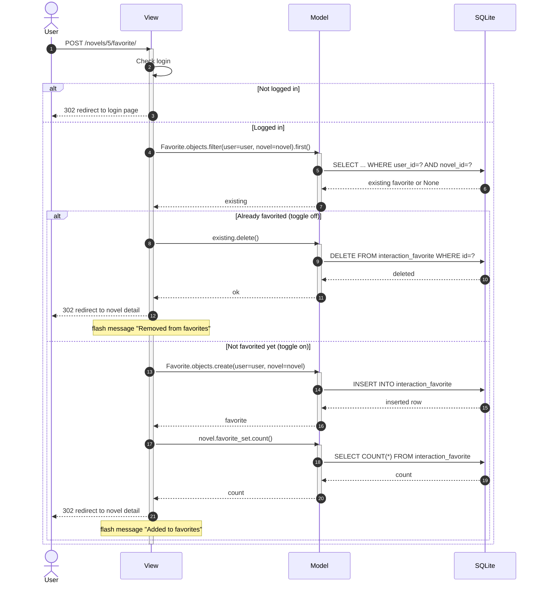
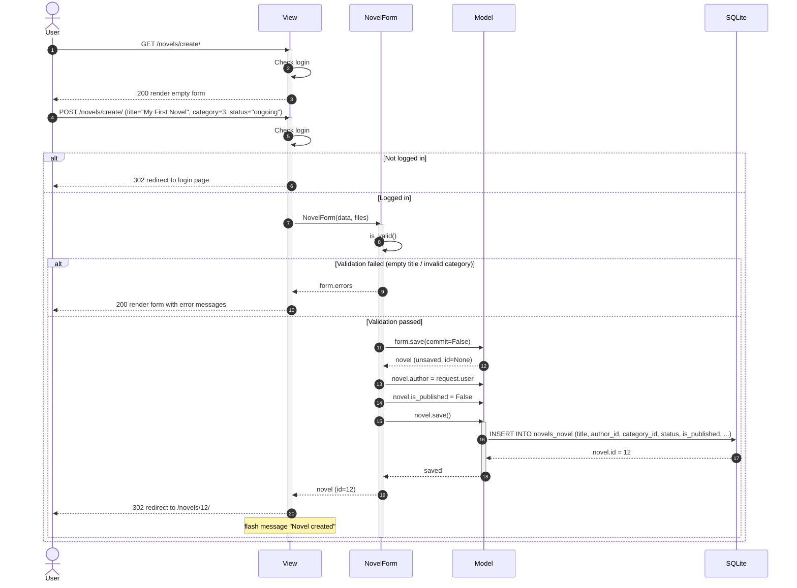
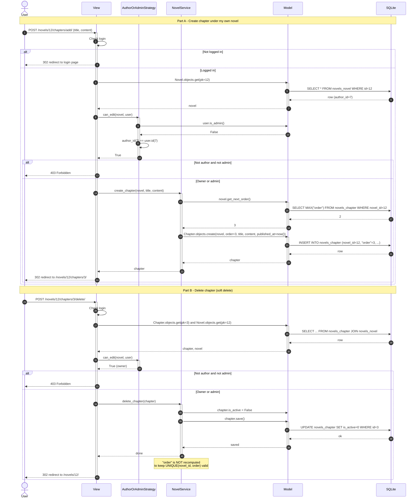
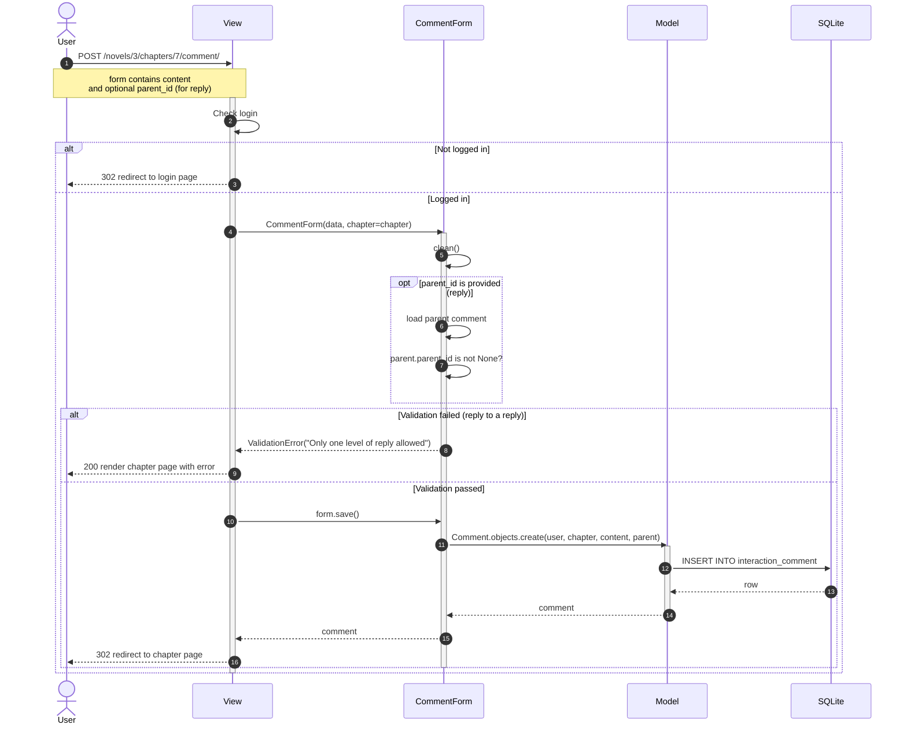
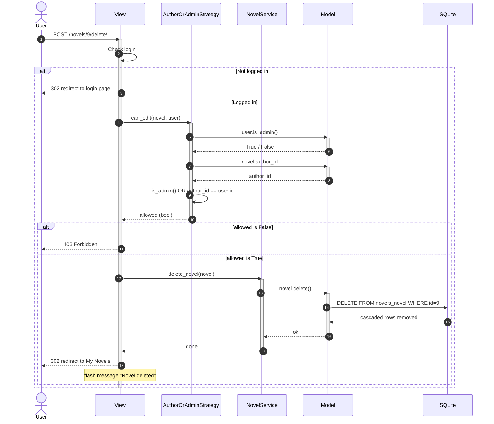
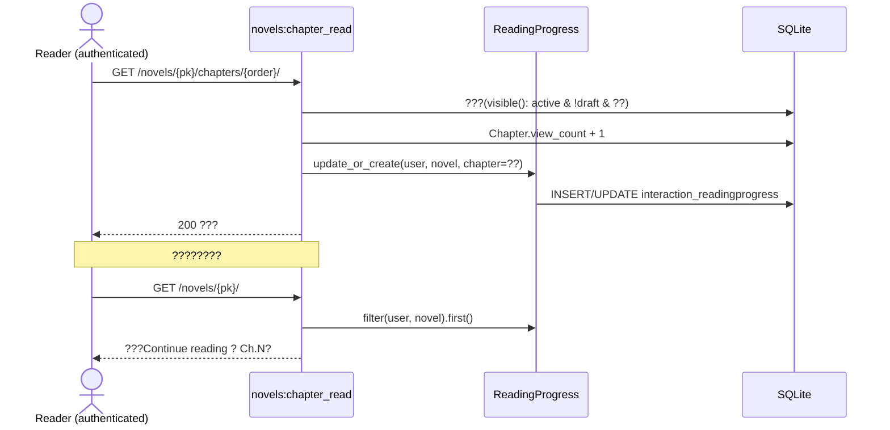
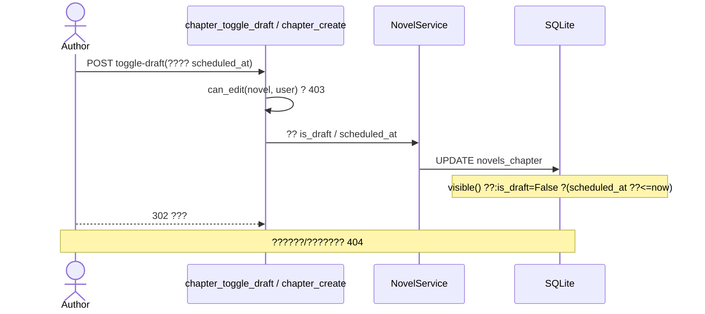
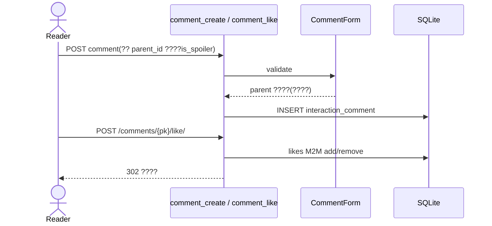
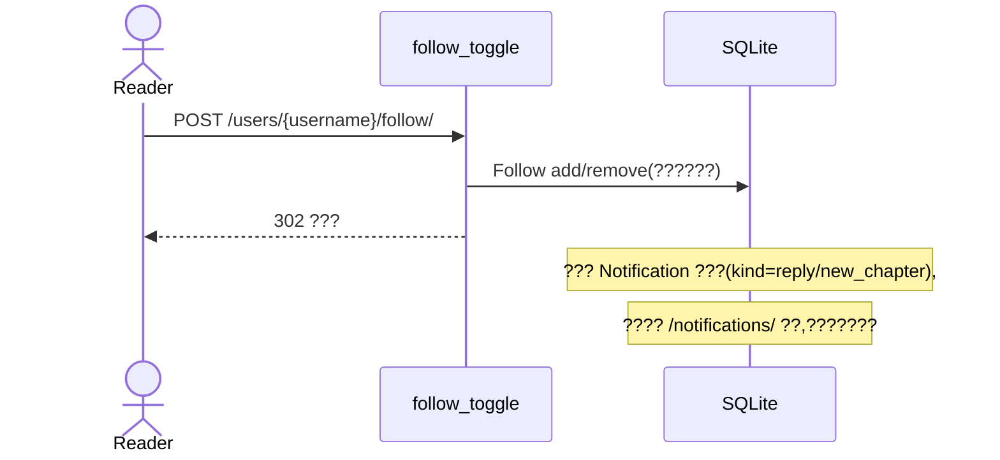
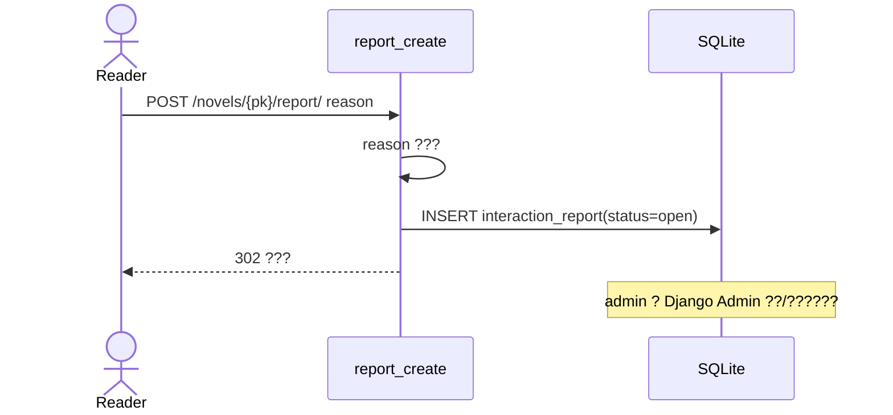

# UML Sequence Diagrams

> Web Novel Platform — 五個核心用例的動態行為模型
> 需求基準見 [`../../agent.md`](../../agent.md)；類別見 [`02-class-diagram.md`](02-class-diagram.md)；資料表見 [`03-er-diagram.md`](03-er-diagram.md)。

## 為什麼需要這份文件

Use Case 圖只回答「系統能做什麼」，Class / ER 圖只回答「資料長什麼樣」。**兩者之間缺了「一次操作實際上跑了哪些步驟」**。Sequence Diagram 補上這一段，同時也是設計模式（Service Layer、Strategy）存在的直接證據。

## 五張圖的敘事順序

這五張不是隨機挑選，而是**沿著一條完整的創作→互動生命週期**排列：

```text
SD-2 建立新書  →  SD-3 在自己書下建章節  →  SD-1 讀者收藏
                        ↓                        ↓
                  SD-5 刪除作品            SD-4 留言／回覆
```

| 圖 | 誰觸發 | 對象 | 資料變化 |
|---|---|---|---|
| **SD-2** | 已登入用戶 | 作品（**建立**） | `INSERT novels_novel` |
| **SD-3** | 作品作者 | 章節（建立／刪除） | `INSERT` / `UPDATE is_active` |
| **SD-1** | 已登入用戶 | 收藏 | `INSERT interaction_favorite` |
| **SD-4** | 已登入用戶 | 留言／回覆 | `INSERT interaction_comment` |
| **SD-5** | 作品作者 / admin | 作品（**刪除**） | `DELETE` + CASCADE |

> 注意 **SD-2 與 SD-3 的先後關係**：`Novel` 必須先存在，才能在其底下建立 `Chapter`（FK `chapter.novel_id → novel.id`）。因此 SD-3 一律在「自己剛建立的作品」上操作，並以 `AuthorOrAdminStrategy` 驗證歸屬。

## 圖例與共同前提

### 參與者命名對應

| 圖上名稱 | 實體 | 檔案位置 |
|---|---|---|
| **Actor**（`Guest` / `User` / `Admin`） | 瀏覽器中的使用者 | — |
| `View` | Django View（函式或 class-based view） | `novels/views.py`、`interaction/views.py` |
| `Form` / `NovelForm` / `CommentForm` | Django `ModelForm`，負責驗證 | `novels/forms.py`、`interaction/forms.py` |
| `Service` | `NovelService`（Service Layer） | `novels/services.py` |
| `Strategy` | `AuthorOrAdminStrategy` / `CommentOwnerStrategy` | `accounts/permissions.py` |
| `Model` | Django ORM model（Active Record） | `*/models.py` |
| `DB` | SQLite（`db.sqlite3`） | — |

### 請求入口不畫進圖裡

Django 每個請求都經過 `URLRouter → View`，若每張圖都畫這兩段，只會讓圖變得難以閱讀。**本文件假設以下前提**：

```text
Browser --HTTP--> config/urls.py --dispatch--> View
```

`config/urls.py` 是 Front Controller（見 Class 圖的 Design Patterns 表）；圖上一律從 **Actor 直接連到 `View`**。

### `Check login` 的意義

需登入的用例，`View` 內會有一個自訊息 `Check login`，代表：

- 實作上是 `LoginRequiredMixin`（class view）或 `@login_required`（function view）
- `alt` 分支「未登入 → 302 導向 `/accounts/login/`」在每張圖中只保留一次，避免重複

---

## SD-1：收藏／取消收藏（Favorite a Novel）

**對應用例**：`Favorite Novel`　**需求**：D1、D2、A6

> 收藏與取消收藏**共用同一個 endpoint**，由 view 檢查 `Favorite` 是否已存在來決定要建立或刪除（toggle）。



### 說明

| 步驟 | 設計理由 |
|---|---|
| **一個 endpoint、兩種行為** | 收藏與取消收藏是**互斥**操作，不需要兩個 URL；由「是否已收藏」決定分支，前端只需一顆按鈕 |
| 先 `filter().first()` 再決定 | 已收藏時走 `delete()`，未收藏時走 `create()`；兩條路徑都只有一次寫入 |
| 回傳 `302` 而非 `200` | Post/Redirect/Get 模式，避免使用者重新整理造成重複提交 |
| **不顯示收藏數的即時更新** | 圖上在「新增收藏」後才重算 `count()`；取消收藏後由詳情頁重新載入即可，不需額外查詢 |
| `unique_together(user, novel)` | 資料庫層的最後防線：即使併發請求同時通過檢查，唯一約束仍會阻擋重複列 |

### 對應關係

| 圖上元素 | Class 圖 | ER 圖 |
|---|---|---|
| `Model`（收藏） | `Favorite` | `interaction_favorite` |
| `unique_together` | `Favorite.unique_together(user, novel)` | `UNIQUE(user_id, novel_id)` |

---

## SD-2：建立新書（Create a Novel）

**對應用例**：`Create Novel`　**需求**：E2

> 這是平台內容的**起點**：使用者給定書名後，系統在 `novels_novel` 建立一筆新作品，並把 `author` 綁定為目前登入者。
> 新書的 `is_published` 一律為 `False`（未曝光）；「發布」是後續的獨立動作，見下方「發布」段落。



### 說明

| 步驟 | 設計理由 |
|---|---|
| **`GET` 先渲染空表單** | 標準的 Create 流程：先看到表單，填寫後才 `POST`。圖上分成兩段請求避免混淆 |
| `form.save(commit=False)` | 需要先補上 `author` 與 `is_published` 才能存檔；若直接 `save()`，會因為 `author` 未填而失敗 |
| `novel.author = request.user` | **作者身分由伺服器決定，不由表單輸入**。若讓前端傳 `author`，使用者就能偽造作者 |
| `novel.is_published = False` | 新作品一律未公開（E7）；要曝光需另外按「發布」 |
| 驗證失敗回 `200` 而非 `302` | 必須保留使用者已填入的欄位與錯誤訊息 |
| 成功回 `302` 到詳情頁 | Post/Redirect/Get，避免重新整理造成重複建立 |
| **不經過 `NovelService`** | 建作品只涉及單一 model，`ModelForm` 已足夠；service 只保留「跨模型／需算順序」的操作（見 Class 圖的說明） |

### 建立後作品處於什麼狀態

```text
建立（SD-2）  →  is_published=False   →  有人按「發布」才變 True
              ↗
使用者看不到   →   作者自己看得到（我的作品）
```

| 動作 | 誰能做 | `is_published` |
|---|---|---|
| 建立新書 | 已登入用戶 | `False` |
| 發布 | 作者本人 / admin | `True` |
| 下架 | admin | `False` |
| 刪除 | 作者本人 / admin | 記錄消失（硬刪除） |

### 附帶動作：發布（Publish，E7）

「發布」是把作品從「未曝光」切換到「曝光」，流程只有兩步，因此不另立圖：

```text
POST /novels/12/publish/
  → Check login
  → AuthorOrAdminStrategy.can_edit(novel, request.user)   ← 只有作者或 admin
  → NovelService.publish(novel)
        novel.is_published = True
        novel.save()          →  UPDATE novels_novel SET is_published=1
  → 302 redirect to My Novels
```

| 設計點 | 說明 |
|---|---|
| 走 `NovelService.publish()` | 與 Class 圖、SD-3／SD-5 一致：**業務動作放 service，view 只處理 HTTP** |
| 需要權限檢查 | 只有作者本人或 admin 能發布，否則一般人可發布他人作品 |
| **不檢查章節數** | `Chapter` 沒有草稿狀態（一建立即公開），因此不能用「有沒有章節」阻擋發布。零章節的作品發布後，詳情頁顯示「暫無章節」（見 `agent.md` 設計決策第 7 條） |

### 對應關係

| 圖上元素 | Class 圖 | 需求 |
|---|---|---|
| `NovelForm`（表單，不在 Class 圖） | — | E2、G3 |
| `Novel.author` | `Novel` | E2 |
| `Novel.is_published` | `Novel` | E2、E7、F2 |
| `Novel.category` | `Novel`、`Category` | E2、B4 |

---

## SD-3：在自己的作品下建立與刪除章節（Manage Chapters）

**對應用例**：`Manage Chapters`　**需求**：E5、E6

**前提**：作品 12 是由目前使用者建立的（見 SD-2），因此 `novel.author_id == user.id`。

這張圖回答兩個問題：

1. **誰可以建章節？** 只有作品作者本人或 admin（`AuthorOrAdminStrategy`）
2. **章節編號怎麼維持？** 新增要算 `order`，刪除**不可以**動 `order`



### 說明

| 步驟 | 設計理由 |
|---|---|
| **先查出 `novel` 再檢查權限** | 權限規則是「是不是**這本書**的作者」，因此必須先有 `novel` 物件才知道要比對誰 |
| `can_edit(novel, user)` 而非 `can_edit(chapter, user)` | 章節沒有 `author` 欄位，作者是透過 `chapter.novel.author` 取得。傳 `novel` 讓策略不必知道物件型別 |
| 權限通過才呼叫 service | service 只管資料，不管權限（見下方說明）；view 是唯一的守門人 |
| `get_next_order()` 計算 `order` | 由 model 提供，避免 view 自己寫 `Max('order')` 聚合 |
| 寫入 `published_at` | 章節**沒有草稿狀態**，一建立即公開；`published_at` 只是章節建立時間，供「最近更新」顯示。作品曝光由 `is_published` 決定（SD-2） |
| **刪除只改 `is_active`** | 若真正 `DELETE`，留言（`Comment.chapter` CASCADE）會一起消失，使用者無法回溯 |
| **刪除後不重排 `order`** | 假設 1,2,3 刪掉 2，若把 3 改成 2，會與「未來新增的第 4 章」或既有資料衝突；保留 `order=3` 的空洞最安全 |
| 唯一約束 `(novel, order)` | 新增時 `get_next_order()` 保證不撞號；刪除不重排保證不產生衝突 |

### 為什麼 service 不檢查權限

權限檢查統一在 **view 層**呼叫 `PermissionStrategy`，理由：

- `NovelService` 的每個方法都能在單元測試中直接呼叫，不必先偽造 `User` 或 `Request`
- 權限規則只有一處（`accounts/permissions.py`），改規則時不會漏改 service
- service 可被 management command、seed script 重用，不受 HTTP session 限制

### 與 SD-5 的關係

| | SD-3 | SD-5 |
|---|---|---|
| 對象 | 章節（子物件） | 作品（聚合根） |
| 權限判斷 | `AuthorOrAdminStrategy.can_edit(novel, user)` | `AuthorOrAdminStrategy.can_edit(novel, user)` |
| 刪除方式 | **軟刪除**（`is_active=False`） | **硬刪除**（`delete()` + CASCADE） |
| 拒絕結果 | `403 Forbidden` | `403 Forbidden` |

> 兩張圖使用**同一個策略類別**，證明 Strategy Pattern 的可重用性：規則寫一次，`Novel` 與 `Chapter` 共用。

### 對應關係

| 圖上元素 | Class 圖 | 需求 |
|---|---|---|
| `AuthorOrAdminStrategy.can_edit()` | `PermissionStrategy` 子類 | A6、E5 |
| `NovelService.create_chapter()` | `NovelService` | E5 |
| `Novel.get_next_order()` | `Novel` | E6 |
| `NovelService.delete_chapter()` | `NovelService` | E5 |
| `Chapter.is_active` / `Chapter.published_at` | `Chapter` | E5、F2 |

> **未畫進圖的 service 方法**：`reorder_chapter(chapter, new_order)`（E6 拖曳排序）流程形狀與 Part B 類似（檢查權限 → 調整 `order` → 存檔），但需要額外處理「兩章互換時的唯一約束暫存」。為了避免圖過於複雜，此方法僅在 Class 圖與測試案例中呈現。

---

## SD-4：留言與一層回覆（Comment and Reply）

**對應用例**：`Post Comment` / `Reply to Comment`　**需求**：D3、D6、G3

`Reply to Comment` 在 Use Case 圖中是 `Post Comment` 的 **generalization**（回覆就是帶 `parent` 的留言）。因此這兩者共用**完全相同**的流程，差別只在 `parent` 是否有值。圖上用 `opt` 區塊表示。



### 說明

| 步驟 | 設計理由 |
|---|---|
| 驗證放在 `CommentForm.clean()` | 這是**表單層**規則（使用者輸入），不是資料完整性規則，因此不放 `Model.clean()` 也不放資料庫 |
| 檢查 `parent.parent_id` | 若父留言本身已有父留言，代表這會成為第三層，必須拒絕 |
| 兩者共用一個 View | `Reply` 只是多了 `parent_id`，不需另開 view；Use Case 圖的 generalization 正好對應此實作 |
| 一層回覆的顯示 | `Comment.get_replies()` 取得子留言，模板以縮排呈現 |

### 為什麼不用資料庫約束

`CHECK` 無法跨列查詢「父留言的父留言」。要資料庫層保證，得用 trigger 或正規化，對 prototype 而言成本過高。**應用層驗證 + 文件說明**是合理取捨，已在 `03-er-diagram.md` 的約束總表標明。

### 對應關係

| 圖上元素 | Class 圖 | 需求 |
|---|---|---|
| `CommentForm.clean()` | （表單，不在 Class 圖） | G3 |
| `Comment.parent` | `Comment`（自關聯） | D6 |
| `Comment.get_replies()` | `Comment` | D6 |

---

## SD-5：刪除作品的權限決策（Delete Novel with Permission Check）

**對應用例**：`Delete Novel`　**需求**：E4、A6、F1

這張圖是 **Strategy Pattern** 存在的直接證據。若沒有 Strategy，這段判斷會散落在每個 view 的 `if` 裡；抽出來後，`Novel`、`Chapter`、`Comment` 三種物件可共用同一套「作者或 admin」語義。



### 說明

| 步驟 | 設計理由 |
|---|---|
| `can_edit()` 而非 `can_delete()` | 編輯與刪除的權限規則相同（作者本人或 admin），用同一個方法避免重複 |
| `user.is_admin()` 而非直接讀 `is_staff` | Class 圖定義 `User.is_admin()` 為 admin 判定的**單一權威來源**；日後若改規則（例如加入「版主」群組），只需改一處 |
| 回 `403` 而非 `404` | 物件確實存在且使用者已知其 ID，隱藏存在性沒有意義；`403` 讓除錯與測試更明確 |
| 先檢查權限，再呼叫 service | service 不負責權限（見 SD-3 說明），避免每個 service 方法都要傳入 user |
| **作品是硬刪除** | 與章節／留言的軟刪除不同：作品是聚合根，使用者預期整部作品消失；CASCADE 連帶清除章節、留言、收藏、評分 |

### 三個分支的意義

| 分支 | 條件 | 結果 |
|---|---|---|
| 本人 | `novel.author_id == user.id` | 允許 |
| admin | `user.is_admin()` 為真 | 允許（不論作者是誰） |
| 其他登入者 | 兩者皆否 | `403 Forbidden` |

### 對應關係

| 圖上元素 | Class 圖 | 需求 |
|---|---|---|
| `AuthorOrAdminStrategy.can_edit()` | `PermissionStrategy` 子類 | A6 |
| `User.is_admin()` | `User`（external） | F1 |
| `NovelService.delete_novel()` | `NovelService` | E4 |

---

## 設計模式展現對照

| 設計模式 | 由哪張圖證明 | 具體證據 |
|---|---|---|
| **Service Layer** | SD-3、SD-5 | `View → Service → Model` 三段式；`order` 計算、軟刪除不重排都在 service |
| **Strategy** | SD-3、SD-5 | 兩張圖同用 `AuthorOrAdminStrategy.can_edit()`，證明規則可重用 |
| **Active Record** | 全部五張 | `Model` 自身提供 `objects.create()`、`.save()`、`.delete()`、自訂方法（`get_next_order()`、`is_admin()`） |
| **Template Method**（框架） | SD-2、SD-4 | `Form.is_valid()` / `Form.clean()` 是 Django 提供的 hook，覆寫即可 |
| **Decorator**（框架） | 全部五張 | `Check login` 自訊息 = `@login_required` / `LoginRequiredMixin` |

> **注意**：SD-2（建立新書）**刻意不使用** `NovelService`，因為只涉及單一 model。這反而是好事——證明 Service Layer 不是「到處包一層」，而是只用在需要跨模型或算順序的地方。報告中可以主動說明這個判準。

---

## 需求追溯表

| 需求 | 說明 | 由哪張圖涵蓋 |
|---|---|---|
| A6 | 權限規則 | SD-1（登入前置）、SD-3（作品歸屬）、SD-4、SD-5（三分支） |
| D1 | 收藏／取消收藏 | SD-1 |
| D2 | 我的收藏 | SD-1（收藏後寫入，列表頁讀取） |
| D3 | 章節評論 | SD-4 |
| D6 | 一層回覆 | SD-4（`clean()` 拒絕第三層） |
| **E2** | **新建作品** | **SD-2** |
| E4 | 刪除作品 | SD-5 |
| E5 | 章節管理 | SD-3（權限 → 新增／刪除、`order` 策略） |
| E6 | 章節排序 | SD-3（`get_next_order()`、不重排） |
| E7 | 發布控制 | SD-2（新書預設 `is_published=False`；發布步驟以文字說明） |
| F1 | Django Admin | SD-5（`user.is_admin()`） |
| F2 | 內容下架 | SD-2（`is_published` 開關）、SD-3（軟刪除） |
| G3 | 表單驗證 | SD-2（`NovelForm.is_valid()`）、SD-4（`CommentForm.clean()`） |

### 為什麼 E7「發布」沒有獨立圖

「發布」的完整流程只有 4 步（檢查登入 → 檢查權限 → `is_published=True` → 存檔），與 SD-2 的存檔段落形狀完全相同。畫成獨立圖會與 SD-2 高度重複，因此以 SD-2 的「附帶動作：發布」段落說明，並在追溯表中標註 `SD-2`。

---

## 已驗證

五段 Mermaid 語法已用 `@mermaid-js/mermaid-cli`（v12.2.0）實際渲染通過，PNG 輸出於同目錄：

| 圖 | 檔案 | 狀態 |
|---|---|---|
| SD-1 收藏作品 | `sequence-1-favorite.png` | ✅ |
| SD-2 建立新書 | `sequence-2-create-novel.png` | ✅ |
| SD-3 章節管理 | `sequence-3-chapter.png` | ✅ |
| SD-4 留言回覆 | `sequence-4-comment.png` | ✅ |
| SD-5 權限刪除 | `sequence-5-delete-permission.png` | ✅ |

## 如何預覽

1. 開 <https://mermaid.live>，貼上任一個 `mermaid` 區塊。
2. 或安裝 VS Code 擴充 **Markdown Preview Mermaid Support** 直接預覽此檔。

---

# v2 ??:?? / ???????

> ????? v2 ????,???????????????? SD-1~SD-5 ???;SD-3/SD-4 ??????????????/?????????/??/????

## SD-6 ??????(C5)



## SD-7 ???? / ????(C6)



## SD-8 ???? + ????(D6 v2)



## SD-9 ???? + ??(v2)



## SD-10 ????(F2 v2)


